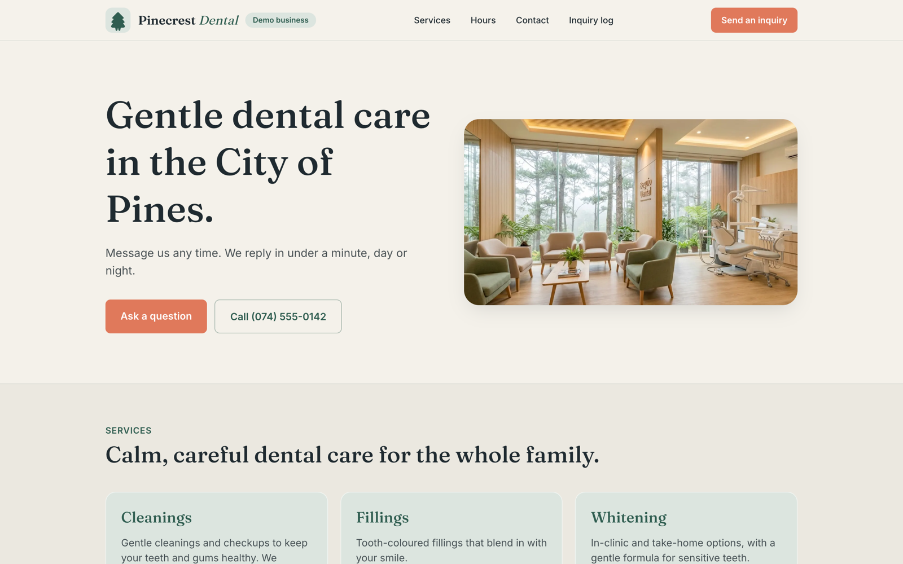
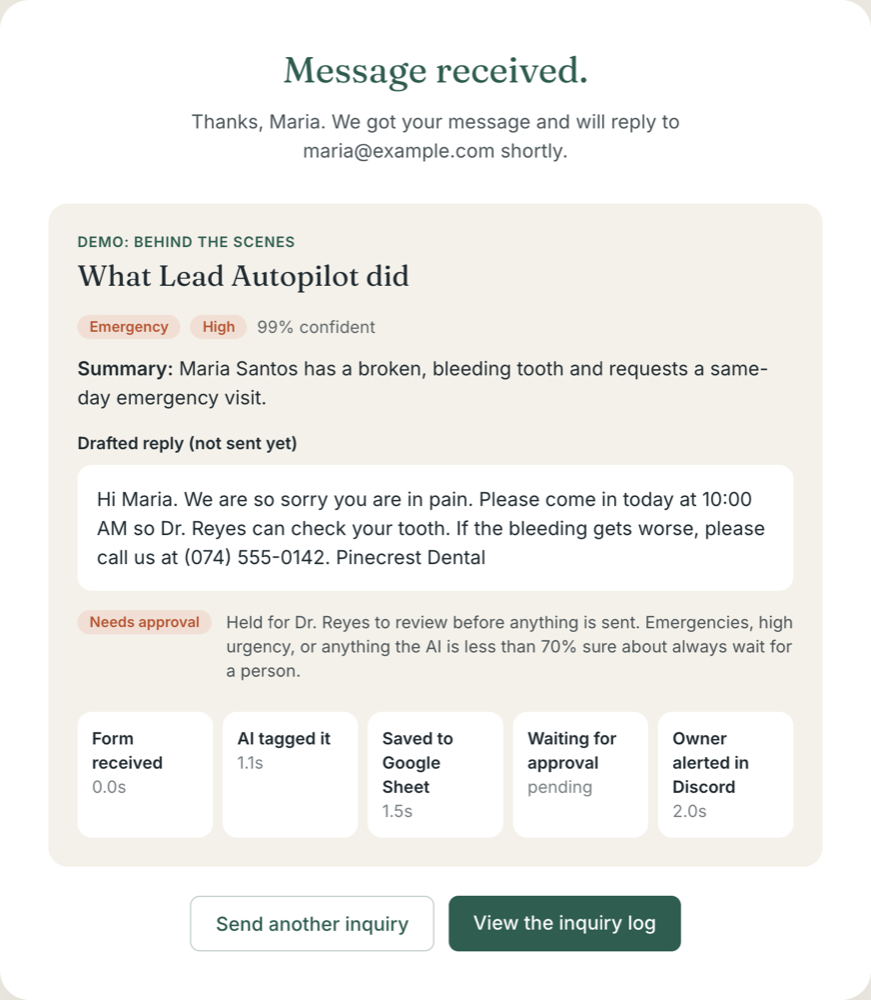
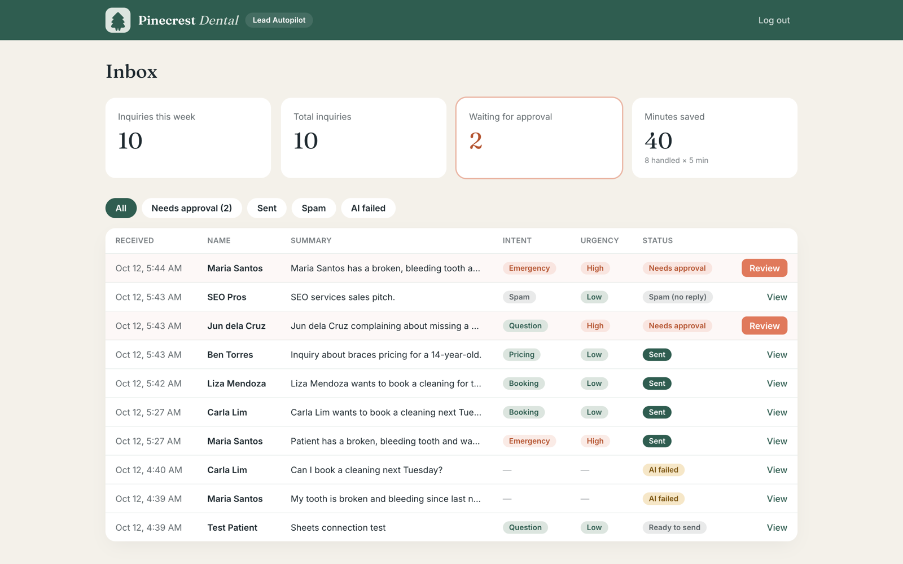
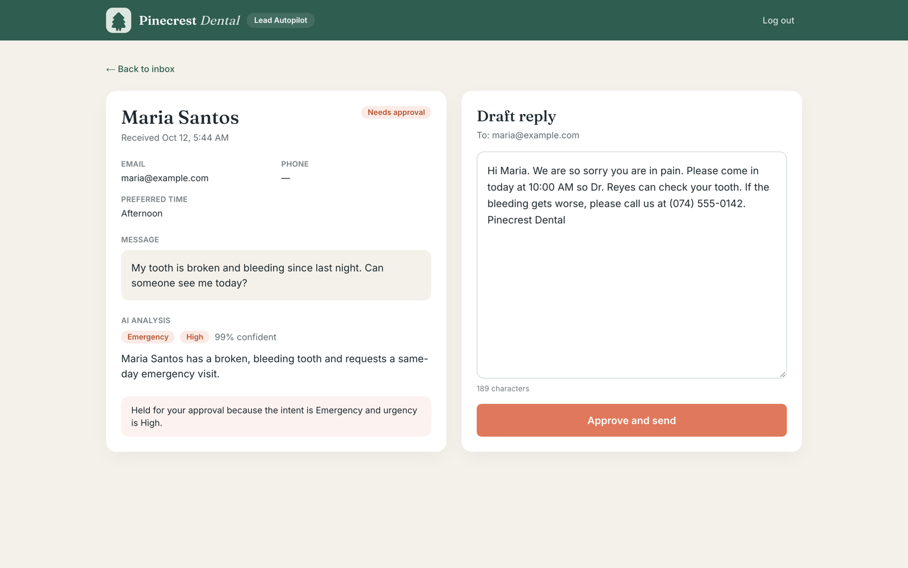
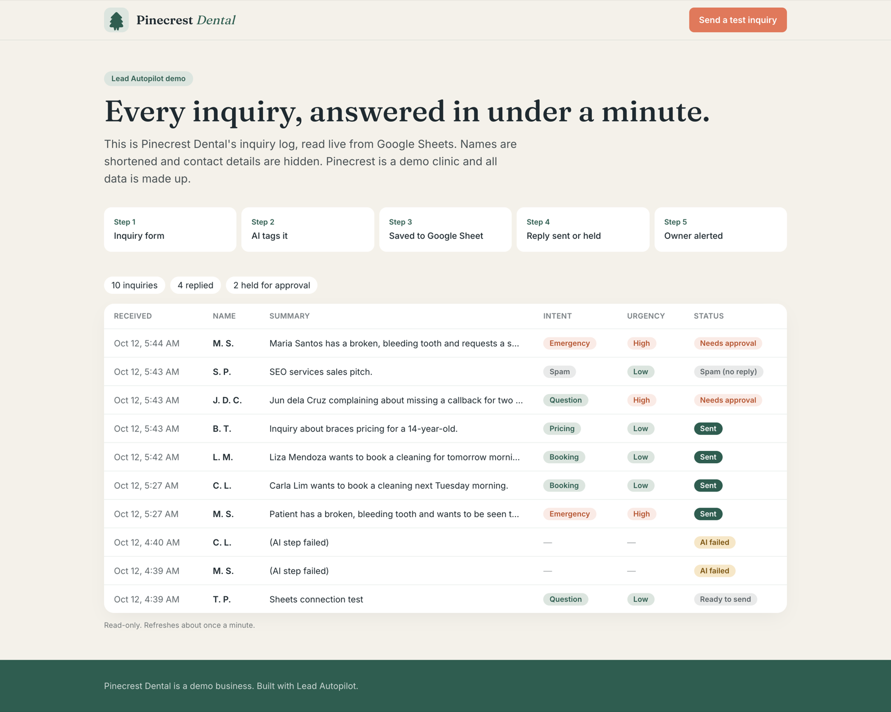
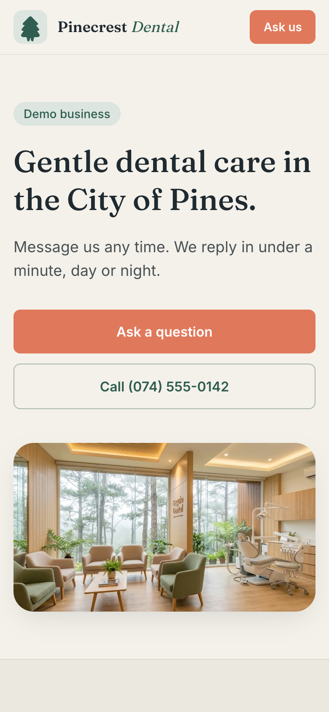

# Lead Autopilot

**Every patient inquiry answered in under a minute, day or night.** Routine questions get a reply right away. Emergencies and anything unclear wait for the dentist's approval.

Lead Autopilot is an inquiry-handling system built for a small dental clinic. When someone submits the clinic's inquiry form, AI tags the message, it's logged to Google Sheets, a drafted reply goes out by email, and the owner gets a Discord alert.

The demo client is **Pinecrest Dental**, a fictional family clinic in Baguio City. All data is made up.

**Live demo:** [lead-autopilot-six.vercel.app](https://lead-autopilot-six.vercel.app) · **Public inquiry log:** [/log](https://lead-autopilot-six.vercel.app/log)



## How it works

```
Inquiry form → AI tags it → Saved to Google Sheet → Routine: reply emailed now
                                                  → Urgent or unclear: held for approval
                                                  → Spam: no reply
                                                 ↘ Owner alerted in Discord (every inquiry)
```

1. A visitor submits the form. It's checked in the browser and on the server (Zod), behind Cloudflare Turnstile, a honeypot field and a rate limit of 5 per hour.
2. `classifyLead()` asks the AI for one JSON shape: intent, urgency, confidence, a one-line summary and a drafted reply.
3. The inquiry is saved as a row in Google Sheets.
4. If it's **routine**, the reply is emailed right away via Resend. If it's an **emergency**, **high urgency**, or the AI is **less than 70% confident**, it waits for approval and nothing is sent. **Spam** gets no reply.
5. The owner gets a Discord alert for every inquiry.
6. In the dashboard the owner can review, edit and **Approve and send** held replies.

**If the AI step fails,** the inquiry is still saved, the owner is still alerted and the patient gets a standard "we got your message" email. No inquiry is lost.

## Screenshots

| What visitors see after submitting | Owner dashboard |
| --- | --- |
|  |  |

| Review and approve a held reply | Public, anonymised inquiry log |
| --- | --- |
|  |  |



## Results

- **20/20** on a fixed test set of sample inquiries: routine bookings, pricing questions, emergencies, angry patients, Tagalog messages, vague messages and spam.
- **About 3 seconds** from submit to the reply being sent, including the AI, the sheet and the alert.
- Replies are in the patient's own language, never promise prices, never give medical advice and never invent clinic facts.
- **Minutes saved** counter on the dashboard: inquiries handled × 5 minutes.

## AI design

- Every AI call goes through `src/lib/ai/classify-lead.ts` using the [AI SDK](https://ai-sdk.dev). The model is one environment variable:
  ```
  AI_MODEL=google/gemini-3.5-flash-lite        # free Google AI Studio tier
  AI_MODEL=anthropic/claude-sonnet-5.5         # plus ANTHROPIC_API_KEY, no code change
  ```
- The output is validated against a Zod schema, with a 15-second timeout.
- The prompt is in its own file, `src/lib/ai/prompt.ts`.
- `npm run test:ai` runs the 20 sample inquiries in `scripts/samples.ts` and prints a scorecard. Rerun it after every prompt change.

## Running it locally

```bash
cp .env.example .env.local   # fill in the keys below
npm install
npm run dev                  # http://localhost:3000
```

| Variable | What it's for |
| --- | --- |
| `AI_MODEL`, `GOOGLE_GENERATIVE_AI_API_KEY` | AI tagging and drafted replies ([Google AI Studio](https://aistudio.google.com/apikey)) |
| `ANTHROPIC_API_KEY` | Only if `AI_MODEL` is an `anthropic/*` model |
| `GOOGLE_SERVICE_ACCOUNT_EMAIL`, `GOOGLE_SERVICE_ACCOUNT_PRIVATE_KEY`, `GOOGLE_SHEET_ID` | Inquiry log. Share the sheet with the service account as Editor; the tab and headers are created automatically. |
| `RESEND_API_KEY`, `EMAIL_FROM`, `EMAIL_TEST_RECIPIENT` | Reply emails. `EMAIL_TEST_RECIPIENT` sends every patient email to one inbox (demo mode). |
| `OWNER_ALERT_WEBHOOK_URL` | Discord webhook for owner alerts |
| `NEXT_PUBLIC_TURNSTILE_SITE_KEY`, `TURNSTILE_SECRET_KEY` | Cloudflare Turnstile spam check |
| `ADMIN_PASSWORD` | Owner dashboard login at `/dashboard` |

Useful scripts:

| Command | What it does |
| --- | --- |
| `npm run test:ai` | Runs the 20-message AI test set |
| `npm run test:sheets` | Checks the Google Sheets connection |
| `npm run typecheck` / `npm run lint` | Static checks |

## Project structure

```
src/app/page.tsx                  Clinic homepage and inquiry form
src/app/api/inquiry/route.ts      Spam checks → processInquiry()
src/lib/process-inquiry.ts        The pipeline: AI → Sheet → email → alert
src/lib/ai/                       classifyLead(), prompt
src/lib/sheets.ts                 Google Sheets log
src/lib/email.ts, alerts.ts       Resend replies, Discord alerts
src/app/dashboard/                Owner login, inbox, review and approve
src/app/log/page.tsx              Public read-only log
docs/PLAN.md                      Plan, brand and build phases
```

## Tech stack

Next.js 16 (App Router, Cache Components), TypeScript, Tailwind CSS 4, AI SDK 7 (Gemini, swappable to Claude), Zod, Google Sheets API, Resend, Discord webhooks, Cloudflare Turnstile, Vercel.
